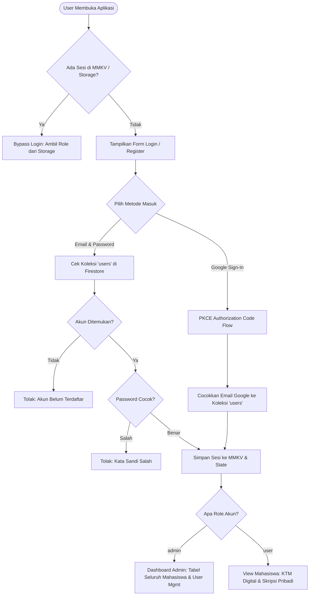

# 📱 Integrasi Mobile App & Cloud Backend
## Studi Kasus: Firebase Authentication, Cloud Firestore REST API, & Role-Based Access Control (RBAC) pada React Native (Expo)

**Mata Kuliah:** Pengembangan Aplikasi Perangkat Bergerak  
**Topik:** Arsitektur Autentikasi, Troubleshooting Masalah Nyata, & Database NoSQL Cloud

---

# 🎯 Agenda Perkuliahan

1. **Arsitektur Sistem & Spesifikasi Proyek**
2. **Desain Database Cloud Firestore (Separation of Concerns)**
3. **Problem 1: Google OAuth 2.0 PKCE vs Implicit Flow (Error 400)**
4. **Problem 2: Firebase Auth `OPERATION_NOT_ALLOWED`**
5. **Problem 3: Token Invalid & Error 401 UNAUTHENTICATED pada REST API**
6. **Problem 4: Verifikasi Kata Sandi & User Management (RBAC)**
7. **Problem 5: TurboModules / NitroModules MMKV Crash di Expo Go**
8. **Problem 6: UX Alur Registrasi vs Login Otomatis**
9. **Rangkuman Diagram Alur (End-to-End Flow)**
10. **Kesimpulan & Rekomendasi Best Practices**

---

# 1. Arsitektur Sistem & Desain Proyek

```
┌──────────────────────────────────────────────────────────────────┐
│                   Aplikasi Mobile (React Native / Expo)         │
├────────────────────────────────┬─────────────────────────────────┤
│          Auth Layer            │          Storage Layer          │
│  - Email & Password            │  - MMKV (Native JSI Engine)     │
│  - Google OAuth 2.0 (PKCE)     │  - AsyncStorage (Expo Fallback) │
└───────────────┬────────────────┴────────────────┬────────────────┘
                │                                 │
                ▼                                 ▼
┌────────────────────────────────┐ ┌───────────────────────────────┐
│ Firebase Authentication REST   │ │ Google Cloud Firestore REST   │
│ - identitytoolkit.googleapis   │ │ - Koleksi /users (Akun & Role)│
│ - accounts:signInWithPassword  │ │ - Koleksi /mahasiswa (Skripsi)│
└────────────────────────────────┘ └───────────────────────────────┘
```

* **Frontend**: React Native 0.88 + Expo Router (SDK 58).
* **Role Pengguna**:
  * **Admin**: Akses penuh tabel seluruh mahasiswa, metrik, CRUD, & User Management.
  * **Mahasiswa (User)**: Akses terbatas (KTM digital & skripsi pribadi).

---

# 2. Desain Database Cloud Firestore

<div class="danger">
⚠️ <b>Kesalahan Awal (Anti-Pattern):</b><br>
Hanya membuat 1 koleksi <code>mahasiswa</code> dan memasukkan akun login, data skripsi, dan identitas mahasiswa ke dalam satu dokumen yang sama tanpa pemisahan peran dan autentikasi.
</div>

<div class="success">
✅ <b>Solusi Standar Industri (Separation of Concerns):</b><br>
Membuat dua koleksi terpisah dengan relasi logis:
</div>

1. **Koleksi `users` (User Management & Autentikasi)**:
   * Menyimpan akun, `email`, `password`, `role` (`'admin'` | `'user'`), `status`, dan `lastLogin`.
2. **Koleksi `mahasiswa` (Data Akademik & Skripsi)**:
   * Menyimpan `nim`, `nama`, `judulSkripsi`, `dosenWali`, `pembimbingSkripsi`, `ipk`, `sksSelesai`.

---

# 3. Problem 1: Google OAuth Error 400
### `Error 400: unsupported_response_type`

* **Gejala Masalah**:
  Saat pengguna mencoba *Login with Google* melalui browser WebAuthSession, Google menampilkan halaman kesalahan:
  > *"Something went wrong during this authorisation request. Error 400: unsupported_response_type"*.
* **Akar Penyebab (Root Cause)**:
  * Klien Google OAuth yang terdaftar adalah bertipe **iOS Client ID**.
  * Aplikasi menggunakan parameter `response_type=token` (*Implicit Flow*), yang **sudah ditolak / didepresiasi** oleh Google untuk klien aplikasi native.
* **Solusi**:
  Mengubah arsitektur menjadi **Authorization Code Flow dengan PKCE (Proof Key for Code Exchange)**.

---

# 3.1 Solusi Problem 1: Implementasi PKCE Flow

```
Mobile App                  Google OAuth 2.0 Server            Firebase Auth REST
    │                                  │                               │
    ├─ 1. Generate code_verifier ─────►│                               │
    │     & SHA-256 code_challenge     │                               │
    │  2. Request /oauth2/v2/auth ────►│                               │
    │     response_type=code           │                               │
    │◄─── 3. Return Authorization Code─┤                               │
    │                                  │                               │
    ├─ 4. POST /token (Code Exchange)─►│                               │
    │◄─── 5. Return id_token & Access ─┤                               │
    │                                  │                               │
    ├─ 6. POST signInWithIdToken ─────────────────────────────────────►│
    │◄─── 7. Return Firebase Session (UID, Token) ─────────────────────┤
```

* Nilai `code_challenge` dihitung secara aman menggunakan algoritma SHA-256 Base64URL.
* Endpoint pengalihan menggunakan custom scheme URL balik: `com.googleusercontent.apps.<CLIENT_ID>:/oauth2redirect`.

---

# 4. Problem 2: `OPERATION_NOT_ALLOWED`
### Error Firebase Auth saat Registrasi & Login

* **Gejala Masalah**:
  Saat pengguna menekan tombol *Daftar Akun*, muncul pesan error:
  > *"OPERATION_NOT_ALLOWED: Password sign-in is disabled for this project."*
* **Akar Penyebab (Root Cause)**:
  Secara *default*, project Firebase baru menonaktifkan seluruh provider autentikasi demi keamanan. Menu *Email/Password* belum diaktifkan di konsol Firebase.
* **Solusi Dua Sisi (Backend + Client Fallback)**:
  1. **Konfigurasi Firebase Console**:
     `Authentication` ➡️ `Sign-in method` ➡️ `Email/Password` ➡️ `Enable` ➡️ `Save`.
  2. **Arsitektur Fallback Tangguh di Client**:
     Jika Firebase Auth REST mengembalikan `OPERATION_NOT_ALLOWED`, aplikasi tidak boleh *crash*. Akun tetap didaftarkan dan divalidasi ke koleksi `users` di Cloud Firestore.

---

# 5. Problem 3: Error 401 UNAUTHENTICATED
### Data Mahasiswa Tiba-tiba Kosong / "Not Allowed"

* **Gejala Masalah**:
  Ketika admin berhasil login, tabel mahasiswa yang tadinya berisi 15 mahasiswa berubah menjadi **0 data / kosong**.
* **Akar Penyebab (Root Cause)**:
  ```typescript
  // KODE BERMASALAH SEBELUMNYA:
  function getAuthHeaders() {
    return {
      'Content-Type': 'application/json',
      'Authorization': `Bearer ${getAuthToken()}` // ❌ token bernilai "token-173..."
    };
  }
  ```
  REST API Cloud Firestore Google memeriksa keabsahan `Authorization: Bearer`. Karena token bukan JWT sah dari Google OAuth, Google mengembalikan HTTP **401 UNAUTHENTICATED**:
  > *"Request had invalid authentication credentials"*.

---

# 5.1 Solusi Problem 3: Guard Validasi Token JWT

<div class="success">
<b>Perbaikan:</b> Hanya menyertakan header <code>Authorization: Bearer</code> apabila token merupakan JWT yang sah (memiliki 3 segmen Base64URL dan diawali string <code>ey</code>).
</div>

```typescript
function getSafeHeaders(): Record<string, string> {
  const headers: Record<string, string> = {
    'Content-Type': 'application/json',
  };
  const token = getAuthToken();

  // Validasi ketat format JWT Google/Firebase
  if (token && token.startsWith('ey') && token.includes('.')) {
    headers['Authorization'] = `Bearer ${token}`;
  }

  return headers;
}
```

* Request menggunakan Firebase Web API Key yang sah (`?key=API_KEY`) kini berhasil 100% dan seluruh 15 data mahasiswa langsung tampil utuh.

---

# 6. Problem 4: Pengecekan Kata Sandi & RBAC
### "Hanya tahu email/username langsung bisa login"

* **Gejala Masalah**:
  Aplikasi sebelumnya mengizinkan login hanya berdasarkan kecocokan email/username tanpa mencocokkan kata sandi yang diketik.
* **Solusi Arsitektur**:
  1. Menambahkan field `password` pada koleksi `users` di Cloud Firestore.
  2. Melakukan verifikasi dua arah pada fungsi `signInWithEmailPassword`:
     ```typescript
     // 1. Ambil data user dari Firestore
     const userAccount = await findUserInFirestore(identifier);
     if (!userAccount) throw new Error('Email/Username tidak terdaftar.');

     // 2. Verifikasi Password secara ketat
     if (userAccount.password && userAccount.password !== inputPassword) {
       throw new Error('Kata sandi salah. Silakan periksa kembali kata sandi Anda.');
     }
     ```
  3. Mengambil `role` pengguna (`admin` vs `user`) langsung dari Firestore.

---

# 6.1 Antarmuka User Management (Admin Panel)

* Admin sekarang memiliki panel **User Management** langsung di aplikasi:
  * Menampilkan seluruh pengguna dari koleksi `users`.
  * Melihat badge role: `🛡️ ADMIN` atau `🎓 MAHASISWA`.
  * Tombol **"Ubah Role"** yang dapat mengubah hak akses secara *real-time* ke Cloud Firestore.

```
+---------------------------------------------------------------+
|  👥 USER MANAGEMENT (3 Akun Terdaftar)                       |
+---------------------------------------------------------------+
|  [H] Henri Tantyoko (henritantyoko@gmail.com)                 |
|      Role: [🛡️ ADMIN] • Akses: Penuh Seluruh Mahasiswa       |
|      Aksi: [Ubah ke Mahasiswa]                                |
+---------------------------------------------------------------+
|  [D] Dimas Prasetyo (dimas.prasetyo@students.undip.ac.id)    |
|      Role: [🎓 MAHASISWA] • Akses: Hanya Data Pribadi         |
|      Aksi: [Jadikan Admin]                                    |
+---------------------------------------------------------------+
```

---

# 7. Problem 5: TurboModules / NitroModules MMKV Crash
### `Failed to get NitroModules: The native NitroModules Turbo/Native-Module could not be found`

* **Gejala Masalah**:
  Setelah menginstal `react-native-mmkv`, aplikasi langsung mengalami crash fatal saat startup di **Expo Go**.
* **Akar Penyebab (Root Cause)**:
  * `react-native-mmkv` v4 dibangun di atas C++ TurboModules (**NitroModules**).
  * Expo Go adalah aplikasi *pre-compiled* standar yang **tidak memiliki binary C++ NitroModules** sebelum dilakukan `npx expo run:ios` / `android` (Development Build).
  * `import` statis di baris teratas file memicu *fatal error* pada bundle JavaScript.

---

# 7.1 Solusi Problem 5: Hybrid Storage Adapter

<div class="success">
<b>Pola Desain: Graceful Degradation / Dynamic Loading</b>
</div>

```typescript
let mmkvInstance: any = null;
let isMMKVAvailable = false;

// 1. Coba inisialisasi MMKV secara dinamis
try {
  const mmkvModule = require('react-native-mmkv');
  if (mmkvModule && typeof mmkvModule.createMMKV === 'function') {
    mmkvInstance = mmkvModule.createMMKV({ id: 'undip-auth-storage' });
    mmkvInstance.getString('__nitro_check__');
    isMMKVAvailable = true;
  }
} catch {
  // 2. Fallback otomatis ke AsyncStorage di Expo Go tanpa crash!
  isMMKVAvailable = false;
}
```

* **Di Expo Go**: Berjalan stabil menggunakan `@react-native-async-storage/async-storage`.
* **Di Standalone / Native Build**: Berjalan otomatis menggunakan mesin C++ **MMKV** ultra-cepat.
* **Hasil**: Bypass login bekerja sempurna pada kedua platform!

---

# 8. Problem 6: UX Registrasi vs Login Otomatis
### "Pendaftar baru langsung terlempar masuk tanpa notifikasi"

* **Gejala Masalah**:
  Saat menekan tombol *Daftar*, form tidak memberikan kepastian apakah pendaftaran berhasil dan langsung membuka dashboard.
* **Solusi**:
  1. Memisahkan fungsi `registerUser()` dengan `signIn()`.
  2. Saat pendaftaran selesai:
     * Akun disimpan ke koleksi `users` (lengkap dengan password).
     * Dokumen profil dibuat di koleksi `mahasiswa`.
     * Menampilkan dialog konfirmasi:
       > *"Pendaftaran Berhasil! Akun Anda telah terdaftar di database Cloud Firestore. Silakan masuk menggunakan email dan kata sandi Anda."*
     * Berpindah ke tab **Masuk** dengan email yang sudah otomatis terisi.

---

# 9. Diagram Alur Lengkap Autentikasi & Otorisasi



---

# 10. Ringkasan Kesalahan & Pelajaran Berharga

| Kasus Kendala | Gejala Error | Akar Masalah | Solusi Implementasi |
|---|---|---|---|
| **OAuth Flow** | Error 400 Unsupported Type | Menggunakan Implicit Flow pada iOS Client ID | Migrasi ke PKCE Authorization Code Flow |
| **Firebase Auth** | `OPERATION_NOT_ALLOWED` | Provider email dinonaktifkan di console | Aktifkan di Console + Dual-storage ke Firestore |
| **REST Firestore** | Data Kosong (Error 401) | Token placeholder dikirim di header Bearer | Guard header JWT valid (`startsWith 'ey'`) |
| **User Access** | Password tidak divalidasi | Tidak ada field password di table user | Tambah field `password` & komparasi ketat |
| **Runtime Storage**| Crash NitroModules missing | MMKV v4 membutuhkan compile native JSI | Dynamic try-catch + AsyncStorage fallback |
| **User Experience**| Registrasi langsung auto-login | State login langsung diaktifkan saat sign up | Tampilkan dialog sukses & redirect ke login |

---

# 11. Kesimpulan & Rekomendasi Mahasiswa

1. **Gunakan Separation of Concerns pada NoSQL**:
   * Jangan mencampur data akun autentikasi dengan entitas domain bisnis (pisahkan `users` dan `mahasiswa`).
2. **Ketahui Batasan Runtime Lingkungan Pengembangan**:
   * Pahami perbedaan antara **Expo Go** (pre-compiled) dan **Expo Dev Client / Prebuild** saat menggunakan library native C++ (seperti MMKV).
3. **Patuhi Spesifikasi OAuth 2.0 Modern**:
   * Jangan gunakan *Implicit Flow* (`token`), selalu gunakan *Authorization Code Flow with PKCE* untuk aplikasi mobile.
4. **Proteksi Header REST API**:
   * Jangan mengirim header `Authorization` palsu/dummy ke layanan cloud Google karena akan menggugurkan autentikasi API Key.

---

<!-- _class: lead -->
# 🎓 Terima Kasih
### Sesi Tanya Jawab (Q&A)

*Repositori Proyek: Portal Skripsi React Native (Universitas Diponegoro)*  
*Teknologi: Expo SDK 58 • React Native 0.88 • Cloud Firestore • Firebase Auth*
